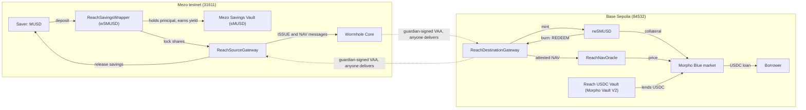

# MUSD Reach

**Earn on Mezo. Borrow on Base.**

MUSD Reach turns Mezo savings into collateral on Base. A saver deposits MUSD into Mezo's own Savings Vault and receives **rwSMUSD** on Base: a transferable, guardian-backed claim on that position. rwSMUSD is accepted as collateral in a live **Morpho Blue** market, so the saver can borrow USDC on Base while their MUSD keeps earning the savings rate on Mezo. Burn rwSMUSD at any time to get the savings position, and every bit of yield it earned, back on Mezo.

**Track: DeFi (Track 1): borrowing, lending and yield.** Live on Mezo testnet and Base Sepolia.

[**Try it in 5 minutes**](https://musd-reach.vercel.app/start) · [Live app](https://musd-reach.vercel.app/app) · [On-chain proof](https://musd-reach.vercel.app/proof) · [Business model](docs/BUSINESS_MODEL.md) · [Contracts](https://musd-reach.vercel.app/contracts) · [Docs](https://musd-reach.vercel.app/docs)

## See it on-chain

Every step of the product has run on public testnets. Click any link to check it yourself.

**Save on Mezo, borrow on Base** (11 November 2026, [evidence](evidence/markets/markets-2026-11-11T16-25-38-477Z.json))

| Step | Transaction |
|---|---|
| 200 MUSD deposited into Mezo's Savings Vault and locked for Base | [Mezo](https://explorer.test.mezo.org/tx/0xe3e6bf3bd88768b350f2b3e6dad456a56dc63c6c73a202897b053fd8ef28c2ec) |
| Guardian-signed message delivered; rwSMUSD minted on Base | [Base](https://base-sepolia.blockscout.com/tx/0x50cbd523d2cc6c4f841426fbc8b10ffb48c8bccd7e2ba85c3029b4dee9887a95) |
| Lender deposits USDC into the Reach USDC Vault, routed into the market | [Base](https://base-sepolia.blockscout.com/tx/0x3a8393aa06c6e1ac13e4eeefc9ea4f484e7b084d13c60d6746cddf1f338dc1d1) |
| rwSMUSD posted as Morpho collateral | [Base](https://base-sepolia.blockscout.com/tx/0x11ce10ecc08798b934658520ae8728bfd24fc68bef5514dc0325280e68182b1c) |
| USDC borrowed against Mezo savings | [Base](https://base-sepolia.blockscout.com/tx/0x7f74aaf3d37a355273f0d3f13872a881dbcd0444d06122dcf7ef6803c9d10df0) |
| Loan partly repaid; the position stays open | [Base](https://base-sepolia.blockscout.com/tx/0x2a1072cad7dbf2bc042ed590cc8060a63ef325916e8dac0ae273f46f94837c5e) |
| Savings NAV published on Mezo, verified into the oracle on Base | [Mezo](https://explorer.test.mezo.org/tx/0x07a58c7889071048777980d37005b7e0d27eb8d8718003e2eb6187a9d73f5619) → [Base](https://base-sepolia.blockscout.com/tx/0xc9f95e91a8544ea7fa1c27cd69b77ded5db03413d3e1ad15d9a641345ee9619a) |

**Round trip back to Mezo** (v2 protocol, 18 steps, [evidence](evidence/real-chain/testnet-2026-10-21T11-23-33-084Z.json))

| Step | Transaction |
|---|---|
| MUSD into savings, shares locked, ISSUE published | [Mezo](https://explorer.test.mezo.org/tx/0x1fdfc665716297805f5af60961df8808ddfbe9466a8d8b6d2ea10809266099d7) |
| rwSMUSD minted on Base | [Base](https://base-sepolia.blockscout.com/tx/0x77f19efa4666a4f0e1f2962ed62c4fbb3f398c16116351d10e83792053a81455) |
| rwSMUSD transferred to a second holder | [Base](https://base-sepolia.blockscout.com/tx/0x52c1cdaa9ace5d1b73fdfd5d0b01f1035b52b019525d925c1b8bcb0fda2f7760) |
| Both holders burn rwSMUSD | [Base](https://base-sepolia.blockscout.com/tx/0x480b9adf783eb270b3d7877633a2b1823a7d6175d936f430983751c6f2808b97) |
| Savings released on Mezo, in shares and in MUSD | [Mezo](https://explorer.test.mezo.org/tx/0x3fadf55034dfe4a21d5015fa6cfeec92c426e96be401cb6c144677db47e86ae0) |
| Protected payout: an unmet minimum is parked, then settled by the recipient | [Mezo](https://explorer.test.mezo.org/tx/0xb89ca393e22a8a13f4c653c3f43902bdf6d26078b5ded52ed21fd34e4c49c29e) → [Mezo](https://explorer.test.mezo.org/tx/0x5165900940b2fc9de436c1802e504f93c768bafaefb0041d3cdc050255562be9) |

The same run proved that forged, replayed and wrong-chain messages are rejected by the live contracts. Market activity from every wallet, including testers, appears live on the [proof page](https://musd-reach.vercel.app/proof).

## The problem: MUSD savers must choose between earning and using

MUSD is Mezo's Bitcoin-backed stablecoin, and its Savings Vault pays holders a share of protocol fees. Yet only a small fraction of MUSD is saved:

| | Amount |
|---|---|
| MUSD in circulation | **$18.8M** ($16.2M on Mezo) |
| MUSD in the Savings Vault | **$1.35M**, about **7%** of supply |
| MUSD outside the vault | **$17.5M** |

*Source: DefiLlama (Mezo Vaults, Mezo USD), 11 November 2026.*

The reason is simple: saved MUSD is stuck. A saver who wants liquidity on another chain has to withdraw, give up the savings rate and bridge. The savings vault also tracks yield per address, so the position itself cannot be moved or used as collateral.

## The solution

1. **Save.** MUSD goes into Mezo's native Savings Vault through the Reach wrapper (wSMUSD), which turns principal plus yield into one share price.
2. **Make it portable.** The shares are locked on Mezo and a Wormhole message mints the same amount of **rwSMUSD** on Base.
3. **Borrow.** Post rwSMUSD as collateral in the Morpho Blue market and borrow USDC. The savings keep earning on Mezo the whole time.
4. **Lend.** Anyone can deposit USDC into the **Reach USDC Vault**, a Morpho Vault V2 that lends into the rwSMUSD market.
5. **Come home.** Repay, burn rwSMUSD, and receive the savings position (or MUSD) back on Mezo with all the yield it earned.

### Growth for Mezo

Every rwSMUSD is backed by MUSD sitting in **Mezo's own Savings Vault**. Borrowing demand on Base therefore turns directly into MUSD deposits on Mezo: more MUSD minted against BTC, more MUSD saved, and a deeper fee flow to savers. Reach removes the "earn or use" trade-off that keeps 93% of MUSD out of the vault.

### Revenue model

Reach curates the Reach USDC Vault and earns a **10% performance fee on the interest lenders earn**, paid to the Reach treasury as vault shares. This fee is **live on Base Sepolia** today. Making savings portable, transferring rwSMUSD and redeeming are free: a saver who never borrows pays nothing. Unit economics, the native MUSD vault, the looping vault and the go-to-market plan are in [docs/BUSINESS_MODEL.md](docs/BUSINESS_MODEL.md).

## Try it yourself

Everything uses free testnet tokens. The [guided page](https://musd-reach.vercel.app/start) ticks off each step as your balances arrive; the full written guide is [docs/USER_TESTING.md](docs/USER_TESTING.md).

1. **Get tokens.** Base Sepolia ETH from the [Superchain faucet](https://console.optimism.io/faucet) and USDC from [faucet.circle.com](https://faucet.circle.com). For the full loop, also get Mezo testnet BTC from [faucet.test.mezo.org](https://faucet.test.mezo.org) and mint MUSD at [testnet.mezo.org/borrow](https://testnet.mezo.org/borrow).
2. **Lend (5 minutes).** Deposit USDC at [/app/lend](https://musd-reach.vercel.app/app/lend).
3. **Full loop (about 45 minutes).** [Make savings portable](https://musd-reach.vercel.app/app/portable/new), [borrow USDC](https://musd-reach.vercel.app/app/borrow) against rwSMUSD, repay, then [redeem](https://musd-reach.vercel.app/app/redeem) back to Mezo.

Found something confusing? [Open an issue](https://github.com/TheWeirdDee/musd-reach/issues/new?title=Testnet%20feedback&labels=feedback).

## What changed since Wave 1

| Wave 1 feedback | Wave 2 delivery |
|---|---|
| Deploy the NAV oracle | `ReachNavOracle` is live and source-verified on Base Sepolia. A scheduled keeper ([workflow](.github/workflows/keeper.yml), [script](scripts/nav-keeper.ts)) checks every 12 hours and carries a fresh Mezo savings NAV across Wormhole well inside the oracle's 72-hour window. |
| Stand up a real market on Base that accepts rwSMUSD | A **Morpho Blue market** (USDC loan, rwSMUSD collateral, 77% LLTV, adaptive-curve rates) on Morpho's official Base Sepolia deployment, funded by the **Reach USDC Vault** (Morpho Vault V2). Borrowed against and repaid on-chain (links above). |
| Get users beyond the team's own wallets | **Borrow** and **Lend** screens in the app, a [self-checking test guide](https://musd-reach.vercel.app/start), a [written tester guide](docs/USER_TESTING.md) with every faucet, and live per-wallet market activity on the [proof page](https://musd-reach.vercel.app/proof). |
| Verify the wrapper and gateways on explorers | The wrapper, both gateways, the receipt and the oracle are **source-verified** on the Mezo and Base Sepolia explorers ([table below](#contracts)). |
| Add a fee or revenue model | A **10% vault performance fee**, live on testnet, plus a free entry and exit. [Business model](docs/BUSINESS_MODEL.md). |
| State the track | **DeFi (Track 1)**, at the top of this page. |

Also new: a data-backed problem statement, a market lifecycle test on a live Base Sepolia fork (lend, borrow, interest accrual and fee, NAV refresh, repay, stale-NAV protection), and a free keep-warm job so the API answers instantly instead of cold-starting.

## How it works



- **Why a wrapper.** Mezo's Savings Vault tracks yield per address, so moving sMUSD itself would split principal from yield. `ReachSavingsWrapper` owns the sMUSD, harvests yield before every deposit and exit, and prices one ERC-4626 share as principal plus claimed and pending yield. Donations cannot move the price. Full model: [docs/ECONOMIC_MODEL.md](docs/ECONOMIC_MODEL.md).
- **Authenticated messages.** The gateways verify Wormhole guardian signatures, the peer emitter, both chains and every payload field, and consume each transfer once. Delivery is permissionless: no relayer or backend can redirect funds.
- **Collateral pricing.** `ReachNavOracle` prices rwSMUSD from the guardian-attested wrapper NAV with a 10% haircut, giving an effective maximum loan-to-value of 69.3%. Borrowing pauses automatically if the NAV is more than 72 hours old.
- **Protected redemption.** A MUSD payout never pays less than the minimum you chose. If it cannot be met, it is parked as a pending settlement: anyone can retry at your terms, and only you can lower the minimum or take shares instead. Details: [docs/SECURITY_FINDINGS.md](docs/SECURITY_FINDINGS.md).
- **Conservation, checkable by anyone.** `pnpm verify reconcile` proves from chain state that `locked wSMUSD = rwSMUSD supply + in-flight issues + in-flight redemptions`.

## Contracts

All contracts are source-verified. Addresses are recorded in [deployments/testnet.json](deployments/testnet.json) and [deployments/testnet-markets.json](deployments/testnet-markets.json).

| Contract | Chain | Address |
|---|---|---|
| `ReachSavingsWrapper` (wSMUSD) | Mezo testnet | [`0xf8cF6fCCC7bcF2860BfAD1Ea4A6018D446eb4306`](https://explorer.test.mezo.org/address/0xf8cF6fCCC7bcF2860BfAD1Ea4A6018D446eb4306) |
| `ReachSourceGateway` | Mezo testnet | [`0xA5c70F8D6B329ED6c2d15D604B66FafC3A6C96d3`](https://explorer.test.mezo.org/address/0xA5c70F8D6B329ED6c2d15D604B66FafC3A6C96d3) |
| `ReachDestinationGateway` | Base Sepolia | [`0x50436eB8F8213c7df773F2c331Bb41e1fecb5a23`](https://base-sepolia.blockscout.com/address/0x50436eB8F8213c7df773F2c331Bb41e1fecb5a23) |
| `RemoteWrapperReceipt` (rwSMUSD) | Base Sepolia | [`0x02777A938e69f848d4413b9033D225f0D1444e89`](https://base-sepolia.blockscout.com/address/0x02777A938e69f848d4413b9033D225f0D1444e89) |
| `ReachNavOracle` | Base Sepolia | [`0xB6f647122EABfa6f7f648E484e62f30d8D2A1817`](https://base-sepolia.blockscout.com/address/0xB6f647122EABfa6f7f648E484e62f30d8D2A1817) |
| Reach USDC Vault (Morpho Vault V2, `reachUSDC`) | Base Sepolia | [`0x30f9Bd5721164d8864E58359c96BD058E55Faab8`](https://base-sepolia.blockscout.com/address/0x30f9Bd5721164d8864E58359c96BD058E55Faab8) |
| Morpho Blue market (USDC / rwSMUSD, 77% LLTV) | Base Sepolia | id `0x040e75a07e0c03497bff9f3c407882919b371d37764bba822227b73f174b72c4` ([created](https://base-sepolia.blockscout.com/tx/0x40acf08d8a8071766adc265a85d6bc6f4ef4ebd6d5cabad29496f1ed405f4e4d)) |

Mezo dependencies: MUSD `0x118917a40FAF1CD7a13dB0Ef56C86De7973Ac503`, Savings Vault proxy `0x6f461c68B2c5492C0F5CCEc5a264d692aA7A8e16`. Base dependencies: Morpho Blue `0xBBBBBbbBBb9cC5e90e3b3Af64bdAF62C37EEFFCb`, Circle USDC `0x036CbD53842c5426634e7929541eC2318f3dCF7e`. All are pinned and checked in [docs/PROTOCOL_VERIFICATION.md](docs/PROTOCOL_VERIFICATION.md). The deployed bytecode of the core contracts matches this repository's build (`pnpm verify bytecode`).

## Quality and security

- **92 Foundry tests:** unit, fuzz and invariant tests, gas-griefing and 10-year liveness tests, plus fork tests against the live Mezo Savings Vault, the real Wormhole Cores, Morpho Blue on Base mainnet (borrowing and liquidation) and the full Reach market on Base Sepolia.
- **SDK (13) and API (23) tests,** Playwright browser suites for transaction intent, the content security policy, accessibility and keyboard use.
- **An independent, read-only verifier** (`reach-verify`) that checks deployments, bytecode, backing and every recorded transaction and VAA straight from public RPCs, without trusting the Reach API.
- **A 33-row threat model** mapped to tests, a Slither pass, and an internal review with every finding fixed or disclosed: [docs/THREAT_MODEL.md](docs/THREAT_MODEL.md), [docs/SECURITY_FINDINGS.md](docs/SECURITY_FINDINGS.md).
- **No admin custody.** After a one-time binding, nobody can mint rwSMUSD or release locked shares except through an authenticated message. Exits cannot be paused.

An external audit is the first milestone before mainnet.

## Build and verify

Requirements: Node 20 or newer, pnpm 11, Foundry 1.8 or newer.

```bash
pnpm install --frozen-lockfile
pnpm --filter @musd-reach/web dev    # http://localhost:3000, reads the live testnet deployment
pnpm --filter @musd-reach/api dev    # http://localhost:8787, indexer and permissionless relayer

pnpm verify all evidence/real-chain/testnet-2026-10-21T11-23-33-084Z.json   # re-check the public round trip
pnpm verify reconcile                                                       # live backing

cd packages/contracts && forge test                                         # unit, fuzz, invariant
FOUNDRY_PROFILE=markets RUN_FORK_BASE_SEPOLIA=true forge test --match-contract ReachMarketsForkTest
```

No keys are needed to browse, read balances or verify. Operators keep keys only in the git-ignored `.env` (see [.env.example](.env.example)). Deployment runbooks: [docs/DEPLOYMENT.md](docs/DEPLOYMENT.md). Testing guide: [docs/TESTING.md](docs/TESTING.md).

| Path | Contents |
|---|---|
| [packages/contracts](packages/contracts) | Wrapper, gateways, receipt, NAV oracle, deploy scripts, Foundry tests |
| [packages/sdk](packages/sdk) | TypeScript reads, message codec, VAA parsing, reconciliation |
| [packages/verifier](packages/verifier) | `reach-verify`, the independent read-only verifier |
| [scripts](scripts) | Lifecycle and market proofs, NAV keeper |
| [apps/api](apps/api) | Reorg-aware indexer, permissionless relayer, read and stats API |
| [apps/web](apps/web) | Next.js app: make portable, borrow, lend, redeem, tracker, proof |
| [evidence](evidence) | Recorded public-testnet runs (`real-chain/`, `markets/`) |

Built with Solidity 0.8.28, Foundry, Wormhole, Morpho Blue and Vault V2, Next.js 16, wagmi and viem, Fastify and PostgreSQL, hosted on Vercel and Render.

## Roadmap

1. **External audit** of the wrapper, gateways and NAV oracle.
2. **Capped mainnet launch:** Mezo mainnet to Base, with a native MUSD vault so savers borrow MUSD against their own savings.
3. **Liquidity bootstrapping:** a MEZO gauge proposal for rwSMUSD lenders, and a one-click looping vault.
4. **More venues:** rwSMUSD listed as collateral by other Base protocols using the same oracle and keeper.

## License

[MIT](LICENSE). Vendored libraries in `packages/contracts/lib` and the vendored Mezo vault source keep their own licenses.
