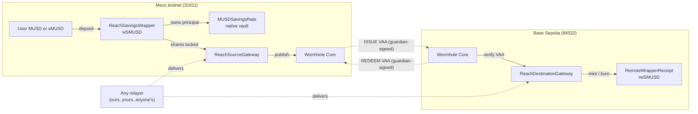

# MUSD Reach

MUSD Reach makes Mezo savings positions portable. Keep the savings position on Mezo while holding or transferring a backed claim on Base Sepolia, then burn the claim to redeem.

**Deployment: Mezo testnet + Base Sepolia**

[Live app / read-only preview](https://musd-reach.vercel.app/app) | [Public proof](https://musd-reach.vercel.app/proof) | [Docs](https://musd-reach.vercel.app/docs) | [Contract registry](https://musd-reach.vercel.app/contracts) | [API health](https://musd-reach-api.onrender.com/health)

## The problem

MUSD savings positions normally stay on the chain where they were created. Moving their value elsewhere often means withdrawing from savings and bridging the underlying token, giving up the original savings position.

## The solution

Reach lets a Mezo saver lock wrapper shares and receive a backed, transferable claim on Base Sepolia. The savings position stays on Mezo while its claim becomes portable. Hold or transfer the claim, then burn it to redeem the corresponding source position.

Current scope: a portable savings-backed receipt on Mezo testnet and Base Sepolia, with a publicly verified round trip. No independently deployed Morpho market, borrowing product or third-party adoption is established. MUSD held on Base must first reach Mezo through a separate bridge; Reach does not automate that entry.

## How it works

1. **Wrap.** MUSD is deposited into the native vault through the wrapper. You receive wSMUSD at the current share price. You can also bring existing sMUSD with `depositSavings`; yield it accrued before the deposit stays claimable by you.
2. **Make portable.** Your wSMUSD is locked in the source gateway, which publishes an ISSUE message. Wrap and lock can be one transaction.
3. **Issue.** Once the Wormhole guardians sign the message (a VAA), anyone delivers it to the destination gateway on Base. The gateway verifies the signature, the emitter, the chains and every payload field, consumes the transfer id, and mints exactly that many rwSMUSD.
4. **Use.** rwSMUSD is an ordinary ERC-20 with permit. Transfer it or hold it. The v2 run transferred it to a second holder.
5. **Redeem.** Burn rwSMUSD on Base. Choose wSMUSD shares or MUSD, with a minimum amount for MUSD. A REDEEM message is published.
6. **Release.** After Base finality, anyone delivers the REDEEM VAA on Mezo. The source gateway releases the exact shares, or redeems them through the wrapper and pays MUSD if at least your minimum is available.

## Why the wrapper is necessary

Native sMUSD tracks yield per address, so moving sMUSD itself would separate the principal from its yield. The wrapper owns the sMUSD and turns principal plus yield into a single share price. A wSMUSD (and therefore an rwSMUSD) is worth `convertToAssets(1)` MUSD at the moment you read it. That value rises with harvested yield and falls only if the native vault is impaired.

| Token | Chain | What it is |
|---|---|---|
| MUSD | Mezo | Mezo's stablecoin |
| sMUSD | Mezo | Native savings vault position. Principal is 1:1 with MUSD; yield is tracked per address and claimed separately |
| **wSMUSD** | Mezo | ERC-4626 share of `ReachSavingsWrapper`. Its value is principal plus claimed and pending yield, so it can move between holders and chains |
| **rwSMUSD** | Base Sepolia | Claim on exactly one wSMUSD unit locked in `ReachSourceGateway` |

### Yield accounting

Full model: [`docs/ECONOMIC_MODEL.md`](docs/ECONOMIC_MODEL.md).

- **Wrapper assets:** `principal + idle + pending`. Principal and claimed yield are tracked internally, not read from `balanceOf`, so donations sent to the wrapper cannot move the share price.
- **Harvest first:** every deposit and exit harvests native yield before pricing. A newcomer cannot buy into yield that belongs to existing holders.
- **Claim-and-hold:** harvested yield stays as MUSD and is not reinvested. There are no fees and no admin mint.
- **Testnet yield:** the testnet vault currently pays no yield to the wrapper. The UI shows no APY or yield history. Positive-yield behaviour is tested locally and on forks only.

Cross-chain conservation, checked by anyone with `pnpm verify reconcile`:

```
locked wSMUSD = rwSMUSD supply + in-flight issues + in-flight redemptions
custody wSMUSD >= locked + pending MUSD settlements
```

## Verified public-testnet results

The v2 public run passed 18 steps, including transfer to a second holder, return in shares and MUSD, a parked settlement and recipient recovery. The read-only verifier checks registry facts, deployed wiring, runtime bytecode, backing, receipts and VAA signatures.

| Level | What |
|---|---|
| **Public testnet (v2)** | Wrap, lock, ISSUE, mint, ERC-20 transfer to a second holder, burn, REDEEM, release in shares and in MUSD, pending settlement and recipient settlement; forged, replayed and wrong-chain messages rejected by the live contracts |
| **Fork only** | Full lifecycle against the live Mezo vault and the real Wormhole Cores; Morpho Blue market acceptance, borrow and liquidation on a Base mainnet fork |
| **Local only** | Fuzz and invariant tests, yield-bearing scenarios, vault impairment, 10-year liveness |
| **Historical real-wallet checks (MetaMask 13.53.0)** | Connect and reject, session persistence, unsupported-network detection, network switch (approved and rejected), account switching, behind the production CSP |
| **Not verified** | Any independent integrator; Morpho on a public network; signing or rejecting a transaction inside a real wallet (what the app asks to sign is checked by a keyless test wallet); Rabby; WalletConnect; screen readers |

## Architecture



Off-chain parts are optional conveniences: `apps/api` indexes events and can run a permissionless relayer, and `apps/web` is the interface. Neither has authority to choose who receives locked funds; delivery executes authenticated messages. A configured relayer key pays its own network gas.

## Supported networks and contracts

| | Chain | EVM id | Wormhole id |
|---|---|---|---|
| Source | Mezo testnet | 31611 | 50 |
| Destination | Base Sepolia | 84532 | 10004 |

**Current deployment (v2)** — [`deployments/testnet.json`](deployments/testnet.json)

| Contract | Chain | Address | Deploy block |
|---|---|---|---|
| `ReachSavingsWrapper` (wSMUSD) | Mezo testnet | [`0xf8cF6fCCC7bcF2860BfAD1Ea4A6018D446eb4306`](https://explorer.test.mezo.org/address/0xf8cF6fCCC7bcF2860BfAD1Ea4A6018D446eb4306) | 16279234 |
| `ReachSourceGateway` | Mezo testnet | [`0xA5c70F8D6B329ED6c2d15D604B66FafC3A6C96d3`](https://explorer.test.mezo.org/address/0xA5c70F8D6B329ED6c2d15D604B66FafC3A6C96d3) | 16279265 |
| `ReachDestinationGateway` | Base Sepolia | [`0x50436eB8F8213c7df773F2c331Bb41e1fecb5a23`](https://sepolia.basescan.org/address/0x50436eB8F8213c7df773F2c331Bb41e1fecb5a23) | 48406337 |
| `RemoteWrapperReceipt` (rwSMUSD) | Base Sepolia | [`0x02777A938e69f848d4413b9033D225f0D1444e89`](https://sepolia.basescan.org/address/0x02777A938e69f848d4413b9033D225f0D1444e89) | 48406337 |

Pinned dependencies (verified live, [`docs/PROTOCOL_VERIFICATION.md`](docs/PROTOCOL_VERIFICATION.md)): Mezo MUSD `0x118917a40FAF1CD7a13dB0Ef56C86De7973Ac503`, native vault proxy `0x6f461c68B2c5492C0F5CCEc5a264d692aA7A8e16` (implementation `0x92D12f0a60906b39d81acD9bf8977b6c824cD98C`).

The runtime bytecode of all four contracts matches this repository's build, with immutables masked (`pnpm verify bytecode`).

**Historical v1** ([`deployments/testnet-v1.json`](deployments/testnet-v1.json)) stays live and is kept only as history. It is affected by F-01 (a relayer could change a MUSD redemption into a share payout by starving gas), which v2 fixes. Its contract source is not reproducible from this repository's git history (disclosure D-01). Do not use v1.

## Redemption and recovery

A MUSD redemption cannot pay less than the minimum you chose, and a relayer cannot force a different outcome. If the payout cannot be met, for example because the share price moved or the native vault is temporarily unavailable, the redemption is **parked as a pending settlement** instead of being paid in another asset. From there:

| Action | Who can call it | Effect |
|---|---|---|
| `retrySettlement(id)` | Anyone | Retries at your original minimum. Never changes your terms |
| `settleWithMinAssets(id, min)` | The recipient only | Settle in MUSD with a new minimum you choose |
| `claimSharesInstead(id)` | The recipient only | Take the wSMUSD shares instead, then exit in kind with `redeemInKind` if the vault is still down |

Settlement uses a gas guard. A delivery or retry sent with too little gas for the payout reverts and changes nothing, so a relayer cannot turn an under-gassed call into a different result (findings F-01 and F-02). Tests cover a 10-year delay, 50 failed retries, an absent relayer and a native vault outage. None of these recovery paths need our backend. The transfer tracker (`/app/transfers/<id>`) shows a pending settlement and offers these actions. A recipient that is a contract unable to make these calls relies on `retrySettlement` alone; if the vault never recovers, its shares stay parked (F-04, disclosed).

## Developer quickstart

Requirements: Node ≥ 20, pnpm 11, and Foundry ≥ 1.8 (the vendored Mezo vault source compiles with solc 0.8.33). Contract dependencies (forge-std, OpenZeppelin) are vendored in `packages/contracts/lib`.

```bash
pnpm install --frozen-lockfile
pnpm --filter @musd-reach/web dev    # http://localhost:3000, reads the v2 deployment from public RPCs
pnpm --filter @musd-reach/api dev    # http://localhost:8787, indexer + relayer; embedded PGlite if DATABASE_URL is unset
```

No keys are needed to browse, read balances or verify. Copy [`apps/web/.env.example`](apps/web/.env.example) to `apps/web/.env.local` for local web configuration. The root [`.env.example`](.env.example) covers all services. The optional API relayer uses `RELAYER_KEY_FILE`; leave it unset for read-only indexing. Wallet interactions remain paused while the reported classification is unresolved.

### Repository

| Path | Contents |
|---|---|
| [`packages/contracts`](packages/contracts) | Foundry: wrapper, gateways, receipt, NAV oracle; unit, fuzz, invariant and fork tests; deploy script |
| [`packages/sdk`](packages/sdk) | TypeScript reads, message codec, VAA parsing, reconciliation, gas policy |
| [`packages/verifier`](packages/verifier) | `reach-verify`: independent, read-only verification CLI |
| [`packages/protocol-registry`](packages/protocol-registry) | Pinned, verified chain facts |
| [`scripts`](scripts) | Lifecycle executor (fork rehearsal or public testnet) that writes evidence |
| [`apps/api`](apps/api) | Indexer (finality- and reorg-aware), permissionless relayer, read API |
| [`apps/web`](apps/web) | Next.js app: portfolio, wrap, make portable, redeem, tracker, history, proof, status, integrations |
| [`docs`](docs) | Protocol verification, economic model, threat model, findings, testing, deployment, status, loan audit |
| [`evidence`](evidence) | Recorded runs: `real-chain/` is public evidence, `fork-rehearsal/` never is |

Pre-build planning documents are kept in [`docs/planning`](docs/planning); the documents above supersede them.

## Verification commands

The verifier is read-only and uses public RPCs. It needs no key and does not use our API.

```bash
pnpm verify registry      # pinned chain facts (chain ids, vault implementation, Wormhole Cores)
pnpm verify deployment    # wiring: peers, bindings, sole minter, consistency level
pnpm verify bytecode      # deployed runtime code == this repository's build
pnpm verify reconcile     # live backing: locked vs supply vs in flight
pnpm verify all evidence/real-chain/testnet-2026-10-21T11-23-33-084Z.json   # every recorded tx, VAA and effect
```

| Evidence | File |
|---|---|
| v2 public round trip (18 steps) | [`evidence/real-chain/testnet-2026-10-21T11-23-33-084Z.json`](evidence/real-chain/testnet-2026-10-21T11-23-33-084Z.json) |
| Verifier transcripts (62/62) | [`verify-…-084Z.txt`](evidence/real-chain/verify-testnet-2026-10-21T11-23-33-084Z.txt), [pre-push rerun](evidence/real-chain/verify-testnet-2026-10-21T11-23-33-084Z-rerun-2026-10-21T13-49Z.txt) |
| v1 public run (historical) | [`evidence/real-chain/testnet-2026-10-20T15-05-14-568Z.json`](evidence/real-chain/testnet-2026-10-20T15-05-14-568Z.json) |
| Fork rehearsals (not public evidence) | [`evidence/fork-rehearsal/`](evidence/fork-rehearsal) |

## Testing

```bash
cd packages/contracts
forge test                                                                       # 75 tests: unit, fuzz, invariants, gas griefing, liveness
RUN_FORK=true forge test --match-path "test/fork/ReachLiveFork.t.sol"            # live Mezo vault + real Wormhole Cores (fork)
RUN_FORK_BASE_MAINNET=true forge test --match-contract MorphoCompatibilityForkTest  # real Morpho Blue on a Base mainnet fork
cd ../..
pnpm test          # SDK (13) and API (23)
pnpm typecheck && pnpm lint
pnpm --filter @musd-reach/web build
```

Browser suites are in `apps/web/e2e` and described in [`docs/TESTING.md`](docs/TESTING.md). They cover fork signing flows, transaction intent (exact approvals, targets and chain ids), wallet rejection, the CSP, responsive layout, accessibility and keyboard use.

## Security model and disclosures

| You trust | For | Notes |
|---|---|---|
| Wormhole guardians | Authenticity of every message | **Testnet uses a single guardian key.** A guardian compromise could mint unbacked rwSMUSD or release locked shares |
| Mezo `MUSDSavingsRate` and its owner | Principal custody | Losses are socialised pro rata to wSMUSD holders; in-kind exit still works |
| Chain finality | Messages are not reorged after signing | Mezo consistency level 202; REDEEM waits for Base finality |
| Guardian role (currently the deployer EOA `0x0F57…Efe6`) | Pausing **new** deposits and locks | Cannot pause exits, release, seize or mint. A single EOA on testnet |

Protocol authentication and exits do not depend on relayers, the Reach API, indexer or website. Users must still verify the chain, target, amount and recipient before signing: a compromised interface could propose a harmful transaction. The deployer cannot arbitrarily mint or release custody after the one-time `bindSourceGateway`; the pause role is described above. Balances and backing are read from chain.

Further reading:
- [`docs/THREAT_MODEL.md`](docs/THREAT_MODEL.md): 33-row attack matrix, each row mapped to a test, plus the Slither triage.
- [`docs/SECURITY_FINDINGS.md`](docs/SECURITY_FINDINGS.md): contract findings, disclosures and current investigations. F-33 (MetaMask classification) is an open release blocker; F-34 records dependency remediation. F-04 (Low) and F-05 (Info) remain disclosed.

There has been no external professional audit.

**Wallet access:** a malicious-site warning was reported during MetaMask connection. [Provider review #305589](https://github.com/MetaMask/eth-phishing-detect/issues/305589) remains unresolved. The app provides read-only access while wallet connections and financial writes are paused. Do not bypass a wallet warning. See the [security status page](https://musd-reach.vercel.app/security). Historical connection tests are not current clearance.

## Deployment

- **Contracts:** v2 is deployed on Mezo testnet and Base Sepolia.
- **Web app and API:** hosted on Vercel ([web app](https://musd-reach.vercel.app)) and Render ([API health](https://musd-reach-api.onrender.com/health)) since 23 October 2026. The free API may take about a minute to wake. [`docs/DEPLOYMENT.md`](docs/DEPLOYMENT.md) has the runbook and the post-deploy checks.
- **Testnet loan:** the deployment was funded with a Mezo testnet loan that is still open. It is documented in [`docs/LOAN_AUDIT.md`](docs/LOAN_AUDIT.md) and is not protocol funds.

## Hackathon

Built for the Mezo hackathon.

## License

[MIT](LICENSE). Vendored libraries in `packages/contracts/lib` and the vendored Mezo vault source keep their own licenses.
