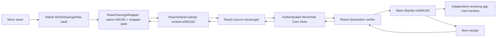

# MUSD Reach — End-to-End Product Requirements Document

> **Planning input, 20 October 2026, kept unchanged as written before the build.** It is not the current status. What was built, deployed and verified is in [`README.md`](../../README.md), [`docs/STATUS.md`](../STATUS.md) and [`docs/SECURITY_FINDINGS.md`](../SECURITY_FINDINGS.md); where this document differs from them, they are authoritative.

**Version:** 2.0 · **Revised:** 20 October 2026  
**Product:** MUSD Reach  
**Tagline:** Your Mezo savings position. Available to the rest of DeFi.  
**Competition:** Built for the Mezo hackathon.
**Primary track:** DeFi; distribution is a secondary benefit.  
**Status:** **CONDITIONAL PRODUCT LOCK — implementation NOT yet verified.** Native savings vault and existing Wormhole NTT transport were checked read-only on public networks. The Reach wrapper, custody, receipt, messaging, complete lifecycle, and lending integration have **not** been deployed or proven.  
**Evidence basis:** Original MUSD Reach PRD v1.0 and *MUSD Reach — protocol and product verification* (20 October 2026). All reported chain facts below are historical observations at specified checkpoints, **not fresh checks by this revision**.

---

## 0. Executive product thesis

**MUSD Reach makes the economic exposure of an actual Mezo MUSD savings position portable to other chains without first withdrawing its principal from Mezo's Savings Vault.** The initial proposed destination is Base Sepolia for a public testnet proof, with Base mainnet integration gated on separate deployment and security review.

The original design—escrow native sMUSD, mint one remote rsMUSD per sMUSD, and assume an appreciating sMUSD/MUSD exchange rate—was **incorrect for the deployed contract**. The checked `MUSDSavingsRate` implementation deposits and withdraws principal 1:1 and accounts for yield separately by address. Transferring sMUSD to custody **does not** transfer yield already accrued to the sender. Subsequent yield accrues to the custody address, not automatically to the remote token owner.

### Chosen corrected design: accumulating wrapper shares

Reach introduces a **Mezo-side yield-accounting wrapper** (`ReachSavingsWrapper`, working share symbol `wSMUSD`) that holds real native sMUSD principal, claims the yield earned **by the wrapper**, and accounts for that yield as part of the assets supporting its own shares. `wSMUSD` is a newly issued wrapper share, **not** native sMUSD and **not** a canonical Mezo token. Reach then locks `wSMUSD` shares in source custody and mints an equal number of **remote wrapper-share claims** (`rwSMUSD`, working symbol) after authenticated messaging. The receipt represents a pro-rata interest in the wrapper's net realizable assets, not a fixed MUSD amount and not a 1:1 native sMUSD claim.

**Economic invariant:** one outstanding remote `rwSMUSD` base unit corresponds to one locked `wSMUSD` base unit, not one native sMUSD unit. Wrapper share value may change as yield is realized, reinvested, fees accrue, or losses occur. Neither a guaranteed APY nor a guaranteed dollar peg exists.

**User job:** A Mezo saver wants to access an actual destination-chain application—ultimately, USDC liquidity against a savings-backed position on Base—without first unwinding the Mezo savings principal. **Morpho Blue on Base** is the named technical integration candidate. A Morpho market accepting the receipt, an appropriate oracle, loan liquidity, borrower demand, and a safe liquidation path **do not yet exist as verified Reach integrations**.

**Do not build a pretend lending protocol or advertise borrowing as live.** Prove savings-backed portability first, then independently validate a genuine receiving application and its economics.

### What is known and what is not

| Question | Verified/read-only finding | Remaining gate |
|---|---|---|
| Does a real savings vault exist? | Yes: mainnet and testnet proxy/implementation bytecode checked | Sponsor support and ongoing configuration, especially testnet |
| Is testnet yield identical to mainnet? | No basis to claim so: testnet `pcv()` and `vaultGauge()` returned zero at checkpoint | Determine actual funding/yield behavior; test with zero yield |
| Is native sMUSD an appreciating ERC-4626 share? | No: checked implementation uses indexed, account-specific yield | Wrapper math, loss handling, claim/harvest behavior |
| Does cross-chain authenticated transport exist? | Existing Mezo testnet ↔ Base Sepolia MUSD NTT VAAs verified at destination Core; altered VAAs rejected; consumed VAAs rejected by NTT | Deploy independent Reach emitters, verifiers, and replay guards |
| Does Reach work end to end? | **Not tested** | Real source wrap/lock → remote mint → burn → native release, with negative tests |
| Does Morpho accept Reach today? | **No Reach market established**; Morpho Blue on Base is a technically relevant target | Oracle, market parameters, lenders, liquidators, partner/user demand |

**Product lock:** Conditional. The design is implementable only if the wrapper accounting and authenticated Reach-specific route survive public-testnet end-to-end and adversarial tests. If not, stop accepting deposits and revise rather than substitute a fake receipt or centralized mint.

---

## 1. User problem, audience, and competitive alternative

### Primary user

A user holds MUSD on Mezo, deposits it into the native savings contract, and wants to use the resulting savings-backed exposure in a destination-chain application. Today, transferring canonical MUSD to Base generally requires giving up the native savings position first. Keeping savings on Mezo preserves exposure but does not by itself make it acceptable collateral in a Base lending market.

### Target user job and desired outcome

**Job to be done:** “I want to obtain USDC liquidity on Base while keeping my Mezo savings-backed principal invested, with a transparent collateral value and a reliable way to repay, recover my position, and exit.” This is a **hypothesis**, not a validated interview or confirmed borrower requirement.

**Candidate receiving application:** Morpho Blue on Base. A new market could use `rwSMUSD` as collateral and USDC as the loan asset **if** all technical, oracle, liquidity, liquidation and risk conditions are met. Permissionless market creation is not market adoption, endorsement, liquidity, or interface listing.

**First proof of external usability:** independently deployed destination application or externally controlled integration that receives and uses real testnet receipt units under enforceable rules. Merely transferring an ERC-20 to a second wallet is a portability proof, **not** lending adoption. A team-deployed Morpho-compatible testnet instance is labelled an **integration harness**, not an independent partner.

### Baselines to beat

1. Keep native sMUSD on Mezo and do nothing on Base.
2. Withdraw savings principal, bridge canonical MUSD to Base and use a current destination-chain lending/yield venue.
3. Use an existing yield-bearing asset already supported by a destination market.
4. Use a mature existing wrapper/bridge if one provides equivalent exposure and better safety/cost.

**Success** requires a meaningful destination workflow, defensible total fees and finality, and no unacceptable increase in risk. **Falsifier:** no borrower/lender/liquidator wants the receipt or the risk-adjusted path is worse than withdrawing and bridging MUSD.

---

## 2. Verified protocol registry and deployment assumptions

### Mezo savings deployments — observed 20 October 2026

| Field | Mezo mainnet | Mezo testnet |
|---|---|---|
| EVM chain ID | `31612` | `31611` |
| Native savings proxy / sMUSD | `0xb4D498029af77680cD1eF828b967f010d06C51CC` | `0x6f461c68B2c5492C0F5CCEc5a264d692aA7A8e16` |
| Implementation at checkpoint | `0xB33C3f97BF3B7df59417D114c694353E42929e87` | `0x92D12f0a60906b39d81acD9bf8977b6c824cD98C` |
| `musdToken()` | `0xdD468A1DDc392dcdbEf6db6e34E89AA338F9F186` | `0x118917a40FAF1CD7a13dB0Ef56C86De7973Ac503` |
| Native sMUSD decimals | 18 | 18 |
| `pcv()` at checkpoint | `0x391EcC7ffEFc48cff41D0F2Bb36e38b82180B993` | zero address |
| Pinned block | `12637951` | `16260405` |
| Block hash | `0xd78260ff1022b281d715ca211c39bdf4ab93d9dd44ff2311696cbec37b05e4a3` | `0xaa679ab3649e02abd4f86400ab1541e3a0c8bbb67d0a3ae73d452daecff73b2f` |

Implementation bytecode matched explorer source in the read-only report. Testnet `vaultGauge()` also returned zero. **Do not display production-equivalent testnet fee/yield claims.** A testnet deployment's long-term recommended/supported status was not independently established; request sponsor confirmation and keep the endpoint configurable.

Historical testnet transaction receipts reported successful: deposit `0xc07eec340a241ffbc80fe1fcabe14ac2b635d9c667f1325f720a6a9c2ff49019`; withdrawal `0x9d6b2dba41bdcadce210d69d811d3f8455006061b0dff65bb1f471bfb07ea562`; yield claim `0x8b667897f71a1f3fed6b9c73158a2e26c425b127430323b8bdbfc65142fc4474`. They are **existing third-party transactions**, not new Reach tests.

### Existing Wormhole infrastructure — testnet only

| Field | Mezo testnet | Base Sepolia |
|---|---|---|
| Wormhole chain ID | `50` | `10004` |
| Core | `0x268557122Ffd64c85750d630b716471118F323c8` | `0x79A1027a6A159502049F10906D333EC57E95F083` |
| Canonical MUSD NTT manager | `0x20888B20e2F5F405d44261dA96467a1b1acE15be` | `0x6590DFF6abEd7C077839E8227A4f12Ec90E6D85F` |
| MUSD transceiver | `0x0E628A1C34c92F0aA85aF998814Ce4f03cAA5913` | `0x2ada2d985Ce69b467d2D8372494Df021BEDfdbf2` |

Two pre-existing **different** MUSD transfers were checked in opposite directions; they were **not** a single-wallet round trip. Destination Core `parseAndVerifyVM` returned valid for both original signed VAAs and invalid for byte-altered payloads. Consumed messages reverted in the NTT transceiver with `TransferAlreadyCompleted(bytes32)` and `isVAAConsumed` returned true. The testnet VAAs used guardian set 0 and one signature. This is evidence of the **existing MUSD NTT route**, **not** a Reach-owned messaging deployment or mainnet security guarantee.

**Reach must deploy its own Wormhole Core-compatible emitters/receivers and prove that those application messages are emitted, signed, delivered and consumed in both directions.** Never use the canonical MUSD NTT manager as an unauthorized `rwSMUSD` minter.

### Network/registry controls

A versioned `protocol-registry.json` must pin addresses, EVM and Wormhole chain IDs separately, source implementation hash, decimals, messaging peer IDs, trusted emitters, finality policies, supported actions, explorer links and last verified blocks. Fail closed if implementation/peer configuration differs unexpectedly. **No production deployment is implied by any testnet registry.**

---

## 3. Correct economic design: native principal, wrapper yield, remote shares

### Native savings semantics — mandatory implementation basis

The checked native implementation exposes `deposit(uint256)`, `withdraw(uint256)`, `claimYield()`, `yieldIndex`, `supplyYieldIndex(address)` and `claimableYield(address)` rather than a standard ERC-4626 conversion interface. Deposits mint equal units of sMUSD principal; withdrawals burn requested sMUSD principal and return that principal in MUSD, subject to actual contract execution. Native transfers checkpoint sender/receiver yield: **accrued sender yield stays with the sender**. Future yield on principal owned by the wrapper accrues to the wrapper. Do not describe native sMUSD as automatically increasing in redeemable principal value.

### Chosen wrapper model

- `ReachSavingsWrapper` accepts actual MUSD or native sMUSD, as separately supported verified paths. Its contract—not a backend—owns deposited native sMUSD and its **future** native yield entitlement.
- A native sMUSD depositor retains any **pre-transfer accrued yield** in their original Mezo account. Reach must show that exclusion clearly; offer an explicit user-initiated native `claimYield()` before wrapping, if desired. Never silently credit that prior entitlement to wrapper shares.
- The wrapper issues `wSMUSD` according to the verified **net realizable MUSD-equivalent assets** it owns: native principal held, claimable wrapper yield when reliably observable and collectible, liquid claimed MUSD, and any audited investment/strategy assets, less liabilities, fees, rounding reserves and losses. **Do not count uncollectible or unverified yield as guaranteed backing.**
- For initial scope, choose **claim-and-hold** rather than automatic reinvestment: wrapper may claim native MUSD yield into its own balance, retaining it as part of total assets. This avoids assuming a working testnet yield stream or compounding strategy. Reinvestment is a separately approved, tested upgrade; **do not call the initial implementation auto-compounding**.
- Wrapper shares are transferable and represent a pro-rata claim on wrapper net assets. Shares can appreciate in *measured* MUSD-equivalent value if yield is actually earned/claimable and collectible; they can also lose value. The wrapper's total share supply does **not** inflate to pay existing holders when yield arrives.
- A remote `rwSMUSD` receipt represents exactly one locked `wSMUSD` share unit, not a native sMUSD unit. Its indicative MUSD value is `remote_wrapper_shares × current_net_assets_per_wrapper_share`, with explicit block freshness, source-risk assumptions and rounding.
- A user cannot both hold free `wSMUSD` and redeem a corresponding live remote `rwSMUSD`. The source shares are locked in custody for the life of the remote receipt.

### Wrapper accounting and anti-dilution requirements

**Core accounting:** Let `A` = conservatively realizable wrapper assets in MUSD base units; `W` = total outstanding wrapper shares; `q` = wrapper shares entering/leaving. Define conversion using integer-safe rounding and an explicit initial-share scale. When `W > 0`, a deposit contributing `d` net assets must mint at most `floor(d × W / A_pre)` shares; redemptions burn shares and return no more than `floor(q × A_pre / W)` net assets after disclosed costs, subject to live withdrawal availability. When `W = 0`, use a documented, audited initial price, and protect against first-depositor inflation/donation attacks (e.g. virtual assets/shares or locked seed shares). Never calculate using JS floating point.

**Important exception:** These formulas are **design specifications**, not assertions that the native vault supports ERC-4626. The wrapper must derive realizable assets from actual native methods, and handle `A=0`, `W>0`, negative yield/loss, donated assets, stale native accounting, fees and zero/dust deposits without division or share-inflation exploits.

**Harvest timing:** Any state-changing wrap, unwrap, deposit, redemption or source share lock must use a clearly defined accrual/checkpoint policy so an incoming depositor cannot capture yield belonging to existing shares and a withdrawing holder cannot leave losses with others. The contract should checkpoint/claim wrapper yield where supported, or apply a proven conservative accounting method, **before** calculating mint/burn price. If accurate accrual or collectability cannot be established, pause new deposits and show why; do not assume a nominal 1:1 share price.

**Partial redemption:** Burn exact wrapper-share units; release an equal amount of locked wrapper shares to the rightful native recipient, or redeem wrapper shares into MUSD using current realizable asset value and live withdrawal logic. Remaining holders retain pro-rata wrapper assets; test all rounding and harvest ordering.

**Testnet zero-yield case:** The product must work safely when `claimableYield(wrapper)=0` indefinitely. In that case, no fictitious growth, APY or historical yield chart. A positive-yield scenario may be exercised in clearly labelled local/fork tests, but never shown as public-testnet observed yield.

### Asset definitions

| Symbol | Meaning | Where |
|---|---|---|
| `MUSD` | Canonical Mezo dollar stablecoin | Mezo and supported canonical NTT networks |
| `sMUSD` | Native savings principal token with holder-indexed yield rights | Mezo only, as verified |
| `wSMUSD` *(new)* | Reach wrapper share of wrapper net savings assets, including wrapper-owned yield | Mezo |
| `rwSMUSD` *(new)* | Remote claim on **locked wSMUSD**, not canonical MUSD/sMUSD | Initially Base Sepolia |
| `MEZO` | Protocol token; not part of default wrapper yield | Separate protocol context |

**Explicit non-goals:** no MEZO gauge stacking; no 1 rwSMUSD = $1 statement; no fixed APR; no user-yield ownership claim before the wrapper acquired the native principal; no fabricated interest or sponsor-endorsed asset status.

---

## 4. End-to-end product flows and transaction states

### A. Native MUSD → wrapped savings → remote receipt

1. Connect wallet on Mezo testnet; read canonical MUSD, sMUSD, wrapper registry and gas balances from chain.
2. Display verified vault implementation/version, native indexed-yield explanation, zero-yield possibility and bridge risk.
3. User specifies MUSD amount and Base Sepolia recipient; preview **wrapper shares**, not native sMUSD exchange-rate shares. Show fees, minimum shares, quote source block and expiration.
4. User approves canonical MUSD to wrapper with bounded allowance; wrapper deposits MUSD into the actual native savings contract and measures actual sMUSD principal received. Any required user approvals and intermediate actions are explicit.
5. Wrapper checkpoints assets and mints `wSMUSD` with audited dilution-safe math. UI independently reads minted balance.
6. User authorizes exact `wSMUSD` shares to `ReachShareCustody`; custody transfers shares and records a unique issuance commitment including exact share units, recipient, chain, peer, nonce and message version.
7. **SOURCE_LOCKED** means funds are held on Mezo, not yet available on Base. Wait for specified source finality and an authenticated Reach application VAA.
8. Destination messenger verifies VAA, trusted emitter, payload, chain IDs, intended receiver, nonce and replay state, then mints exact `rwSMUSD` share units once.
9. UI reads destination mint transaction and finalized balance; status becomes **BACKED_REMOTE**. Display the native wrapper share value only as an **indicative, source-block-stamped** number.
10. User may hold/transfer receipt or use a separately verified application; do not imply an existing Morpho market.

### B. Native sMUSD holder entry

1. Read native principal and `claimableYield(user)` separately.
2. Warn: pre-existing yield does **not** accompany transferred sMUSD. Provide a separate optional native `claimYield()` action that the user signs; show actual claimed MUSD.
3. User deposits selected native sMUSD principal into wrapper; wrapper receives principal and acquires **future** yield rights from that point forward.
4. Wrapper mints dilution-safe `wSMUSD` shares based on its current assets and the deposited principal; continue from A6.
5. Show user-held native yield left behind as a separate asset/entitlement, not as a hidden Reach balance.

### C. Existing canonical Base MUSD entry (optional)

Use the official canonical MUSD NTT bridge **as a separate user-authorized transaction**, verify arrival on Mezo, then follow flow A. A Base wallet signature cannot automatically authorize Mezo vault spending. Handle insufficient Mezo gas, bridge rate limits, wrong recipient, delayed VAA and abandoned halfway steps. No fictional atomic one-click promise.

### D. Receipt transfer and application use

A current `rwSMUSD` owner may transfer it on the destination network. Economic rights move with the receipt to the new holder; wrapper yield accrues collectively to wrapper assets rather than being assigned by a remote holder-by-holder yield index. A partner app may hold receipt only under explicit authorization. **No owner who transferred or burned a receipt can redeem the same shares.**

### E. Remote burn → source release → optional native MUSD exit

1. Current receipt owner chooses exact `rwSMUSD` shares, Mezo recipient and whether to receive `wSMUSD` shares or request wrapper redemption to MUSD.
2. Show that returning wrapper shares is the simplest guaranteed share-denominated exit *subject to message delivery*; actual MUSD redemption also depends on live wrapper/native vault liquidity and current share value.
3. Destination burns exact receipt units and emits unique authenticated redemption intent.
4. Source verifier checks finalized burn proof, enrolled remote peer, amount, source custody reservation, nonce and unconsumed transfer ID.
5. Custody releases exactly corresponding `wSMUSD` shares to designated Mezo recipient **once**. If native MUSD is requested, a separate user-authorized or pre-authorized wrapper redemption burns those shares and pays the actually realizable MUSD amount.
6. UI marks **REDEEMED** only after source release/withdrawal receipt and actual recipient balance readback. It never reports a guaranteed dollar amount from the remote burn alone.

### F. Delay, replay, cancellation and incident recovery

- Pending source lock: retry the **same** authenticated message; no duplicate remote issue.
- A timeout **alone never authorizes a refund**. Unlock without mint requires cryptographically or contract-enforced proof that remote issuance cannot later occur.
- Burned remote receipt: hold native shares reserved until authenticated release. Retried delivery is idempotent; no second release.
- Native vault paused or wrapper lacks liquid assets: offer claim in `wSMUSD` if safely available, or display an honest pending MUSD exit; do not invent a liquidity guarantee.
- Unexpected vault implementation or messenger peer change: halt new entry/issuance, preserve carefully tested exit options and surface incident state.
- Source and destination disagree: mark `RECONCILIATION_PENDING`, never fabricate balanced supply or show a completed transfer.

### G. Read-only judge reproduction

A public `/proof/canonical-run` must link to a **new Reach-created** deposit/wrap/lock, source VAA, destination mint, actual receipt use/transfer, destination burn and native release. Include negative proof of altered/foreign emitter rejection, duplicate issue and duplicate burn rejection. A verified historical MUSD NTT transfer **cannot** substitute for any of these Reach-specific steps.

---

## 5. State machines and conservation invariants

### Claim lifecycle

`NOT_STARTED → NATIVE_DEPOSIT_PENDING → WRAPPER_SHARES_MINTED → SOURCE_LOCK_PENDING → SOURCE_LOCKED → SOURCE_FINALITY_WAIT → REACH_MESSAGE_VERIFIED → REMOTE_MINT_FINALIZED → BACKED_REMOTE → REMOTE_BURN_PENDING → REMOTE_BURN_FINALIZED → RETURN_MESSAGE_VERIFIED → SOURCE_RELEASE_FINALIZED → UNLOCKED_OR_NATIVE_REDEEMED`.

Side states: `REVERTED`, `QUOTE_EXPIRED`, `VALUE_STALE`, `INSUFFICIENT_GAS`, `DELIVERY_DELAYED`, `PROOF_INVALID`, `REPLAY_REJECTED`, `VAULT_PAUSED`, `WRAPPER_ACCOUNTING_UNAVAILABLE`, `RECONCILIATION_PENDING`, `RECOVERY_REQUIRED`, `OUTCOME_UNKNOWN`, `FATAL_INVARIANT_BREACH`.

### Required machine-checked invariants

1. **Wrapper assets:** `A` is independently reconstructable from native sMUSD principal, wrapper-owned yield and MUSD assets **net of** liabilities and losses, with a documented collectability policy.
2. **No dilution:** mint/redeem conversion cannot extract another holder's accrued value by deposit/withdraw timing, rounding or donations.
3. **Backing:** at mutually consistent finalized checkpoints, `locked_wSMUSD = finalized_remote_outstanding + pending_issue_shares + pending_burn_release_shares`, with each share classified exactly once and no other custody liabilities omitted. For asynchronous checkpoints, report a reconciliation interval and uncertainty rather than forcing equality.
4. **Exact share denomination:** remote mint/burn units equal locked/released **wSMUSD** units after a declared decimal conversion; no floating-point math.
5. **No double claim:** locked source wrapper shares cannot be withdrawn while a remote receipt or in-flight issuance obligation can still mature.
6. **Authenticated issue:** only a finalized, verified source custody commitment from the exact trusted Reach emitter may mint; relayer/backend alone cannot mint.
7. **Burn before unlock:** only an authenticated finalized remote burn may release matching source shares.
8. **Replay resistance:** message/transfer ID and nonce consumed once per direction; identical retry cannot mint or release twice.
9. **Cross-domain binding:** source/destination EVM chain IDs, Wormhole chain IDs, emitter, receiver, asset, wrapper version, direction, recipient, amount, nonce and protocol version are bound into signed message semantics.
10. **Yield ownership:** wrapper-owned yield supports all outstanding wrapper shares pro rata; pre-transfer user yield is excluded; neither remote transfers nor partial redemptions duplicate rewards.
11. **Unknown is not settled:** an indexer row, API flag, pending VAA or successful source transaction alone does not prove remote receipt or final native payment.

### Message format (design, not deployed ABI)

```typescript
type ReachMessageV2 = {
  protocol: 'MUSD_REACH';
  version: 2;
  direction: 'ISSUE' | 'REDEEM';
  sourceEvmChainId: bigint;
  destinationEvmChainId: bigint;
  sourceWormholeChainId: number;
  destinationWormholeChainId: number;
  sourceEmitter: `0x${string}`;
  destinationReceiver: `0x${string}`;
  sourceWrapper: `0x${string}`;
  sourceCustody: `0x${string}`;
  remoteReceipt: `0x${string}`;
  transferId: `0x${string}`;
  nonce: bigint;
  wrapperShareUnits: bigint;
  recipient: `0x${string}`;
};
```

Validate and encode using audited protocol-specific serialization; the type above is a requirements sketch, **not** a claim that Wormhole accepts this TypeScript structure directly. Guard upgrades, peer rotation, consumed state and replay across protocol versions.

---

## 6. Architecture and contracts



### Contract inventory

| Module | Network | Responsibility | Hard prohibition |
|---|---|---|---|
| Native `MUSDSavingsRate` | Mezo | Real deposit/withdraw/claimYield | Never rewrite/assume ERC-4626 |
| `ReachSavingsWrapper` | Mezo | Own native principal; checkpoint/claim wrapper yield; mint/burn pro-rata wSMUSD | No fabricated APY or arbitrary admin share mint |
| `ReachShareCustody` | Mezo | Lock/release exact wSMUSD, record in-flight obligations | No release on relayer assertion or timeout |
| `ReachSourceMessenger` | Mezo | Emit issue VAA, verify return VAA | No untrusted peer |
| `ReachDestinationMessenger` | Base Sepolia | Verify issue VAA, emit redemption VAA, consume IDs | No replay or backend-only authority |
| `RemoteWrapperReceipt` | Base Sepolia | ERC-20 `rwSMUSD` exact remote share representation | No arbitrary owner mint/seizure |
| `ReserveLens` / reconciler | Both/read-only | Publish source assets, custody shares, remote supply, pending sets | Never authorize mint from indexer alone |
| `ReachRiskOracle` *(conditional)* | Base mainnet or test harness | Risk-adjusted, fresh wrapper collateral valuation for Morpho | No fixed $1 or naive source-only price |
| `EmergencyGuardian` | Both | Restrict new issuance, configure peers under documented controls | No silent unrestricted withdrawal |

**Security posture:** immutable where feasible; otherwise disclose upgrade roles, multisig/timelock, tested migration and source/destination pause compatibility. Do not let a single backend key mint remote tokens, seize custody, forge burn proofs or unilaterally rewrite accounting. Relayers may submit authentic messages but may not create their own attestations.

### Data and API

- Chain readers with multiple RPC sources, finality checkpoints and reorg handling.
- Yield/accounting observer that separates native principal, wrapper-owned accrued/claimed yield, user-owned pre-transfer yield, wrapper shares, custody shares and remote receipts.
- Message queue with idempotent delivery and provenance, no financial authority.
- Reconciler that checks consistent source/destination finalized snapshots and preserves `UNKNOWN` states.
- Public evidence exporter and reproducible read-only verifier.

Suggested endpoints: `GET /v1/networks`, `/v1/vault/native-state`, `/v1/wrapper/assets`, `/v1/wrapper/share-price`, `/v1/positions/{wallet}`, `/v1/quotes/wrap`, `/v1/quotes/unwrap`, `/v1/transfers/{id}`, `/v1/backing/reconciliation`, `/v1/messaging/health`, `/v1/integrations`, `/v1/proof/{runId}`. Any write-intent endpoint prepares **wallet-authorized** calldata only. Each quote includes source block, freshness, amount units, fee and slippage bounds.

**Recommended stack:** Foundry/Solidity/OpenZeppelin, Next.js/React/TypeScript, viem/wagmi, TypeScript chain indexers, PostgreSQL and a deterministic independent proof CLI. Tool choices are implementation suggestions, not protocol evidence.

---

## 7. Named receiving application: Morpho Blue

### Target workflow

User locks wrapper shares on Mezo → receives `rwSMUSD` on Base → deposits it as collateral in a **real, funded, independently usable Morpho market** → borrows USDC → repays → withdraws receipt → burns receipt → releases `wSMUSD` on Mezo → optionally redeems wrapper to native MUSD.

**This workflow is NOT available today as a verified Reach feature.** Do not place an active “Borrow USDC” button until every below gate is passed on the target network.

### Reported Base mainnet technical facts

Morpho Blue contract `0xBBBBBbbBBb9cC5e90e3b3Af64bdAF62C37EEFFCb` was checked for deployed code. The report also found enabled Adaptive Curve IRM `0x46415998764C29aB2a25CbeA6254146D50D22687` and a 38.5% LLTV at its checkpoint. **Do not interpret these as an approved Reach market configuration or recommended risk settings.** No official Base Sepolia Morpho endpoint was established by the investigation.

### Hard integration acceptance gates

1. Deploy an ERC-20-compatible `rwSMUSD` with exact approval/transfer behavior and validated decimals.
2. Specify the concrete `loanToken` (e.g. actual canonical USDC on target network), `collateralToken`, `oracle`, `irm` and `lltv` addresses and validate them on the target Morpho contract.
3. Implement a Morpho-compatible `IOracle.price()` with the documented `1e36` scaling for base-unit collateral/loan valuation. Independently verify native wrapper net asset valuation, collateral liquidity discount, message/redemption delays, bridge/contract failure risk, stale sources and stress scenarios. **Native wrapper share value alone is not a safe liquidation oracle.**
4. Prove lenders actually supplied USDC liquidity, a borrower can borrow/repay, and a liquidator can realize seized receipt value in a stressed market. No invented liquidity or untested liquidations.
5. Apply market initialization/front-running protections and verify enabled LLTV/IRM values; obtain independent risk review before recommending a live market.
6. Distinguish permissionless deployment from Morpho interface listing, Morpho endorsement, curator support and third-party borrower adoption. No such support is presently established.
7. Prove an external user/curator has a real need and understands risks; record actual acceptance requirements and compare to alternatives.

**Testnet honesty:** If no official Base Sepolia Morpho is available, deploy a source-derived Morpho test harness **clearly labelled team-run**, or perform labelled Base-mainnet fork compatibility tests. Neither counts as an independent live Morpho market or partner. A Safe-based receipt custody demonstration is a weaker optional interoperability test, not proof of lending demand.

**Launch gate:** The frontend may display “Morpho integration — research/compatibility only” and link to actual evidence, but must not imply usable USDC borrowing before a market with liquidity, oracle and liquidation path exists.

---

## 8. User experience and frontend acceptance

### Design

A refined, financial-grade product—not a generic DeFi demo. Clear typography and hierarchy, restrained dark graphite/ivory palette with a deliberate accent, purposeful animation, consistent buttons, responsive mobile layouts, accessible contrast and keyboard operation. Use animation to explain source → message → destination transitions, **never** to pretend finality. Support reduced motion and narrow screens. Avoid excessive empty space, fake charts, ornamental numbers and invented yield.

### Pages

| Route | Purpose | Truth requirement |
|---|---|---|
| `/` | Problem, mechanism, why Mezo, actual live proof | No “borrow now” or invented metrics |
| `/app` | Wallet balances and savings exposures | Separate MUSD, native sMUSD, pre-transfer yield, wSMUSD and rwSMUSD |
| `/app/wrap` | Deposit MUSD or existing sMUSD | Explicit native-yield ownership and dilution-safe quote |
| `/app/portable/new` | Lock wSMUSD and initiate remote issue | Show exact share units and source finality |
| `/app/transfers/[id]` | Bidirectional message/settlement tracker | “Pending” never “completed” prematurely |
| `/app/portfolio` | Remote receipt, indicative wrapper NAV, provenance | No double-counting wrapper locked backing |
| `/app/redeem` | Burn remote and recover wSMUSD/MUSD | Separate share release from cash withdrawal |
| `/integrations` | Real active receiving apps and technical targets | Morpho marked unintegrated until proved |
| `/developers` | ABI, SDK, contracts, trust model | Clear difference between wSMUSD and native sMUSD |
| `/proof/canonical-run` | Public read-only canonical lifecycle | Real new Reach txs only |
| `/status` | Vault, yield-read, messenger, bridge and reconciliation health | Stale/unknown are explicit |

### Critical interface copy

- “Native sMUSD principal and accrued yield are accounted for separately. Yield earned before you transfer sMUSD remains in your Mezo account.”
- “Your Reach wrapper shares represent a pro-rata claim on wrapper-held assets; value can rise or fall.”
- “Shares locked on Mezo. Remote receipt **not minted yet**.”
- “Receipt burned on Base Sepolia. Waiting for authenticated Mezo release.”
- “Wrapper shares released. MUSD withdrawal is a separate step and depends on live vault availability.”
- “Morpho borrowing is **not available** through Reach until a market, oracle, liquidity and liquidations are verified.”
- “Testnet yield is not guaranteed or assumed to match mainnet.”

### Causality and accounting strip

Show **Native wrapper assets → Locked wrapper shares → Authenticated message → Remote wrapper-share receipts → Return burn → Native share release**. Each stage shows the actual transaction/message and finalized block, or a candid missing/pending state. Show wrapper assets and receipt supply in **different units**; do not compare MUSD amounts with share counts as though they were interchangeable.

---

## 9. Requirements and acceptance tests

| ID | Priority | Requirement | Pass criterion |
|---|---|---|---|
| R-001 | P0 | Verify native vault ABI/proxy | Code/implementation and principal/yield semantics reproduced at pinned block |
| R-002 | P0 | Wrapper accounting | Correct native yield ownership, NAV, first-deposit defense, rounding and loss behavior |
| R-003 | P0 | Real testnet wrap | Real MUSD/sMUSD into deployed native vault and wrapper; no mocks |
| R-004 | P0 | Source custody | Exact wSMUSD locked; no source release while receipt can exist |
| R-005 | P0 | Reach-specific authenticated issue | New verified VAA from trusted Reach emitter causes exact remote mint |
| R-006 | P0 | Remote receipt | Standard transfer/approve/burn; supply equals authenticated wrapper-share claims |
| R-007 | P0 | Authenticated return | Burn on Base Sepolia → new valid return VAA → source share release |
| R-008 | P0 | Replay/forgery rejection | Duplicate issue/burn, modified VAA and wrong emitter cannot change balances |
| R-009 | P0 | Independent reconciliation | Wrapper NAV, custody shares, remote supply and pending states reconcile |
| R-010 | P0 | Honest UI | No invented APY, dollar peg, yield stream, partner or settled state |
| R-011 | P1 | Partial redemptions | Exact shares, correct NAV/rounding, no yield theft |
| R-012 | P1 | Failure recovery | Same-message retry, reorg/delay, vault pause and explicit unknown state |
| R-013 | P1 | External developer SDK | Third party can independently read backing, verify receipt and integrate |
| R-014 | P1 | Real receiving application | Separate deployed application uses receipt meaningfully; evidence of use |
| R-015 | P1 | Morpho compatibility | Real contract/ABI/oracle/IRM/LLTV tests, clearly labelled harness if not official |
| R-016 | P1 | Borrowing readiness | Actual funded market, risk-reviewed oracle, successful repay and liquidation tests |
| R-017 | P1 | Base canonical MUSD entry | Distinct NTT bridge lifecycle and Mezo user approvals |
| R-018 | P1 | Public judge proof | New Reach transaction IDs, pinned replay script, read-only website |
| R-019 | P2 | Additional remote chain | Global outstanding share accounting; no double issue |
| R-020 | P2 | Strategy reinvestment | Explicit opt-in upgrade, separate harvest/reinvest tests and risks |

**No P0 may be reported PASSED based solely on a design document or existing unrelated NTT transfer.**

---

## 10. Security, threat model, and adversarial matrix

**Threats:** native vault implementation changes; account-indexed yield misallocation; wrapper donation/inflation; uncollectible yield; incorrect NAV; bridge guardians compromised; forged/replayed VAAs; chain reorgs; wrong destination recipient; decimals/rounding mismatch; relayer failure; source/destination disagreement; unauthorized admin upgrade; remote collateral illiquidity; stale or manipulated Morpho oracle.

**Mandatory negative tests:**

1. Deposit after unclaimed wrapper yield and withdraw before harvest: cannot capture existing holder yield.
2. Transfer native sMUSD with prior `claimableYield`: sender keeps prior yield, wrapper only earns future yield.
3. Zero testnet yield and `pcv=0`: system does not fabricate earnings or divide by zero.
4. First-depositor donation/seed, tiny deposits, full withdrawal, negative NAV/loss and rounding across different token decimals.
5. Partial wrapper redemption while remote issue and burn messages are in flight.
6. Fake Reach emitter, altered payload, wrong chain, wrong receiver, wrong wrapper address, replayed issue and replayed burn.
7. Duplicate relayer delivery, delayed attestation, source/destination reorg, missing gas and retry after partial execution.
8. Pause/upgrade/peer rotation without breaking outstanding authorized exit obligations.
9. Stale or contradictory NAV feeds: frontend disables unsafe quotes; Morpho oracle refuses unsafe fresh credit if risk inputs are invalid.
10. Liquidation under slow redemption, deep discount, no receipt liquidity and vault withdrawal outage. Never present safe borrowing unless liquidator exit is demonstrated.

**Release controls:** independent review of wrapper math and bridge authority; Foundry fuzz/invariants; no unlimited user allowances by default; least-privilege roles; disclosed emergency permissions; publicly reproducible source/destination proof; incident plan; explicit experimental/testnet warnings. A successful demo is not an audit.

---

## 11. Testing, evidence and reproducibility

### Testing layers

- Unit/fork: actual native ABI, `claimableYield` before/after transfer, principal 1:1, claim behavior, wrapper asset pricing and harvest.
- Fuzz/invariants: supply conservation, deposits/redeems at arbitrary order, partial exits, fee/loss/donation edge cases, no double yield.
- Messaging: Reach-owned emitter, bidirectional VAA validation, destination/source execution, replay/forgery/peer rejection, reorg and idempotent retry.
- Live public testnet: **one new full round trip** using actual testnet MUSD/native sMUSD and newly deployed Reach contracts, not an isolated local simulation.
- Integrator: receipt used by a separately deployed contract; Morpho interface/oracle tests labelled correctly as real deployment, test harness or fork.
- UI: desktop/mobile, wrong network, wallet rejection, stale reads, no gas, delayed messages, multiple tabs and reload persistence.
- Judge: read-only pinned evidence verified from a clean checkout and at least two independent RPCs where possible.

### Evidence bundle

Every material claim must record: chain ID, contract and implementation addresses, bytecode/build hash, transaction, block/hash, source/destination VAA digest, trusted emitter, actual balances, NAV observation method, share conversion math version, result, verifier command and limitations. Preserve failed tests; do not rewrite `FAILED` to `PASSED` without a fresh reproducible run.

### Already observed versus still required

**Observed in the supplied report:** native vault bytecode/ABI inspection; existing native deposit/withdraw/claim receipts; existing bidirectional MUSD NTT VAA verification and replay rejection in its own transceivers; Base Morpho deployment/parameter compatibility check.

**Not observed:** Reach wrapper asset accounting under live yield; any Reach custody lock; Reach-specific issue/burn VAA; a Reach remote mint; a new Reach redemption; a Reach replay rejection; a Morpho Reach market; lenders/liquidators; independent adopter.

---

## 12. Economics, business model and adoption

**Potential payer:** destination applications or treasuries needing maintained adapters, risk-aware backing data and supported cross-chain savings exposure. **Unvalidated**: fee tolerance, willingness to pay, actual number of Mezo savers wanting Base credit, and whether risk-adjusted borrowing beats alternatives.

Possible revenue: transparently disclosed issue/redemption service fees or B2B integration support. Do not silently skim native yield, imply a protocol revenue stream that does not exist, or add a Reach governance token for the hackathon.

**Unit economics:** real source + destination gas, VAA/relayer cost, optional MUSD NTT bridge, monitoring and security overhead, market liquidity cost and borrowing interest versus baseline withdraw-and-bridge. Show realized costs from live runs, not estimates labelled as actual.

**Adoption evidence sequence:** interview/requirement from real saver or curator → technically compatible wrapper receipt → safe funded market and oracle → real borrower/repayment/liquidation workflow → independent repeated usage. A team-controlled demo market is a technical milestone, **not** commercial validation.

**North-star metric:** amount of genuinely utilized, fully backed `wSMUSD` shares in independently controlled destination applications, measured from finalized transactions. Supporting metrics: full round-trip success, reconciliation discrepancy, net fees, finality latency, NAV freshness, recovery rate, real users and externally funded collateral liquidity.

---

## 13. Build phases and hard gates

### Gate 0 — Protocol truth and sponsor confirmation

- Recheck both native proxy implementations, ABI, yield and `pcv`/gauge state at current blocks.
- Confirm Mezo testnet savings proxy is supported for developer use; record sponsor response or unresolved status.
- Validate testnet token faucet and signer/gas prerequisites without assuming they exist.
- Lock native indexed-yield semantics and chosen wrapper NAV policy in an ADR.

**Stop condition:** cannot safely measure wrapper-owned assets or support native principal exit.

### Gate 1 — Wrapper and economic security

- Implement actual native adapter and `ReachSavingsWrapper` with share issuance, wrapper-owned claimable/claimed yield, pro-rata exit, first-deposit defenses and conservative NAV.
- Fuzz adverse sequences and reproduce pre-transfer native yield behavior.
- Deploy/test against real Mezo testnet savings proxy and record receipts.

**Stop condition:** unallocated yield, dilution, uncollectible accounting, broken zero-yield case or insolvency.

### Gate 2 — Reach-owned cross-chain round trip

- Deploy custody and two application-specific messengers, enroll verified peers and define finality.
- Demonstrate `wSMUSD` lock → **new Reach VAA** → `rwSMUSD` mint → burn → **new return VAA** → native `wSMUSD` release.
- Prove wrong emitter/modified message/replay fails without supply change, including return-leg replay.

**Stop condition:** centralized arbitrary mint, missing authentication, replay or unprovable cancellation.

### Gate 3 — Real receiving app

- Build independent integration SDK and at least one meaningful destination contract interaction.
- Validate Morpho technical requirements; if only a harness/fork is available, label it and **do not claim a real Morpho market**.
- Obtain real borrower/curator acceptance criteria and demonstrate funded, liquidatable market before enabling borrowing.

**Stop condition:** no safe oracle/liquidation/loan liquidity, or no credible demand for lending feature.

### Gate 4 — Production-quality UX, evidence and submission

- Responsive site, stateful transfer tracking, read-only proof, security/risk docs, reproducible verifier, public repository, pitch deck and 2-minute video.
- Every statement in the website, video, README and submission maps to an evidence artifact.
- **Do not substitute a slide/video simulation for a missing financial transaction.**

### Submission scope

Do not cut accounting or security requirements for submission. If a gate is unpassed, present the narrower verified scope truthfully.

---

## 14. Repository and implementation contract

```text
musd-reach/
  apps/web/
  apps/api/
  packages/contracts/mezo/       # native adapter, wrapper, custody, source messenger
  packages/contracts/base/       # destination messenger, remote wrapper receipt
  packages/contracts/shared/     # typed messages, access control, invariants
  packages/contracts/test/       # Foundry unit/fuzz/fork/integration
  packages/sdk/                  # third-party app helpers
  packages/protocol-registry/    # versioned verified chain/token/peer configs
  packages/indexer/
  packages/reconciler/
  scripts/verify-native-vault.ts
  scripts/verify-wrapper-accounting.ts
  scripts/replay-reach-roundtrip.ts
  scripts/reconcile-wrapper-reserves.ts
  scripts/verify-morpho-compatibility.ts
  docs/ARCHITECTURE_DECISIONS.md
  docs/NATIVE_YIELD_SEMANTICS.md
  docs/WRAPPER_ACCOUNTING.md
  docs/THREAT_MODEL.md
  docs/SPONSOR_BEHAVIOUR.md
  docs/INTEGRATION_REQUIREMENTS.md
  docs/RECOVERY_PLAYBOOK.md
  docs/CLAIMS.md
  docs/RUBRIC_ARTIFACT_MAP.md
  evidence/real-chain/
  evidence/negative-tests/
  evidence/canonical-run.json
  .github/workflows/ci.yml
  README.md
```

**Agent contract:** Implement end to end without invented protocol behavior, token balances, partners, or success. Inspect source and live chain before writing ABI assumptions. Use real testnet assets only for public testnet claims. Never use a centralized backend mint signature in place of authenticated VAA. Do not deploy to mainnet or spend real funds without explicit authorization. Stop only at genuine user-required manual steps (wallet signing, faucet/captcha, partner communication, funding/approval). Maintain evidence, CI and source documentation. **Commit per file; never add co-authored-by lines. Do not push or deploy without explicit permission.**

---

## 15. Judge story and competition criteria

**Judge story, conditional on actual proof:** “MUSD Reach takes principal in Mezo's real savings vault, accounts correctly for the vault's address-indexed yield inside a new wrapper, makes wrapper shares portable using authenticated cross-chain receipts, and proves a safe burn-to-release round trip. We are validating whether a destination lending market can safely accept that claim.”

| Criterion | Required artifact | No-go claim |
|---|---|---|
| Mezo integration | Actual native MUSD/sMUSD deposits, wrapper-held principal and yield accounting | Fake vault or assuming native ERC-4626 |
| Business viability | Named Morpho acceptance requirements, real user need, external use and costs | “Morpho partnership” or “borrow USDC now” without proof |
| Technical | New Reach VAA issue and return, custody reconciliation, replay/forgery tests | Reusing existing MUSD NTT success as Reach proof |
| UX | Honest chain stages, native yield separation, risk and redemption visibility | Fixed APR, $1 receipt peg, instant settlement |
| Submission | Public deployed proof, code, deck, 2-minute video, limitations | Fabricated metrics or unsupported claims |

**Pitch sequence:** User problem → why native savings cannot simply be used as Base collateral → account-indexed yield complication → wrapper that correctly owns and allocates future yield → verified source lock and remote receipt → authenticated return → real receiving app result or honest remaining gate → why this is valuable specifically for Mezo.

---

## 16. Open decisions, risk register, and kill criteria

| Decision / risk | Current disposition | Required evidence |
|---|---|---|
| Native yield accounting | **Resolved at design level:** accumulating pro-rata wrapper, claim-and-hold yield | Real contract implementation and anti-dilution tests |
| Prior accrued yield | **Resolved:** remains with native sMUSD depositor | Live readbacks before/after transfer |
| Testnet yield | **Unproven:** `pcv()`/`vaultGauge()` zero at checkpoint | Sponsor confirmation and real observations |
| Wrapper asset collectability | **Unproven** | Safe claim/withdraw, zero-yield and loss tests |
| Reach messaging | **Unproven:** existing NTT route is only transport evidence | New bidirectional Reach VAAs and verifier execution |
| Morpho collateral market | **Not established** | Real oracle, liquidity, liquidator exit and market evidence |
| External user demand | **Not established** | Named user/curator requirements and actual workflow |
| Mainnet security | **Not established** | Independent review, operational controls and separate mainnet deployment |
| Cancellation of pending mint | **Not established** | Protocol-enforced impossibility of later remote mint |

**Kill or materially revise** if: wrapper share math cannot conserve yield under native transfer semantics; actual savings deposits/withdrawals are not supportable; Reach cannot authenticate both directions; receipt backing is not enforceable; redemptions can duplicate claims; no economically credible receiving workflow exists; or liquidation cannot work under realistic asynchronous redemption and liquidity conditions.

---

## 17. Source links and evidence provenance

**Hackathon:** Built for the Mezo hackathon.
**Mezo savings documentation:** https://mezo.org/docs/users/mezo-earn/vaults/musd-savings-vault/  
**Mezo contract registry:** https://mezo.org/docs/users/resources/contracts-reference  
**Mainnet vault proxy:** https://explorer.mezo.org/address/0xb4D498029af77680cD1eF828b967f010d06C51CC  
**Mainnet implementation:** https://explorer.mezo.org/address/0xB33C3f97BF3B7df59417D114c694353E42929e87?tab=contract  
**Testnet vault proxy:** https://explorer.test.mezo.org/address/0x6f461c68B2c5492C0F5CCEc5a264d692aA7A8e16  
**Testnet implementation:** https://explorer.test.mezo.org/address/0x92D12f0a60906b39d81acD9bf8977b6c824cD98C?tab=contract  
**Wormhole addresses:** https://docs.wormhole.com/reference/contract-addresses/  
**Mezo MUSD testnet NTT deployment:** https://github.com/mezo-org/ntt-bridge-musd-testnet/blob/main/deployment.json  
**Morpho market creation:** https://docs.morpho.org/curate/tutorials-market-v1/creating-market/  
**Morpho Blue developer docs:** https://docs.morpho.org/developers/contracts/blue/  
**Morpho oracle deployment:** https://docs.morpho.org/curate/tutorials-market-v1/deploying-oracle/  
**Morpho addresses:** https://docs.morpho.org/developers/contracts/addresses/  
**Morpho interface listing policy:** https://docs.morpho.org/get-started/resources/interface-listing-policy/

**Primary supplied evidence:** *MUSD Reach — protocol and product verification*, checked 20 October 2026, read-only; *MUSD Reach — End-to-End Product Requirements Document* v1.0. This v2 PRD **corrects the design based on that report**, but has **not** independently re-executed its RPC calls or deployed contracts. Where the report established only a candidate or technical possibility, this PRD labels it accordingly.

---

## 18. Final product acceptance checklist

- [ ] Sponsor confirms supported testnet savings endpoint and live implementation registry is rechecked.
- [ ] Native indexed-yield transfer semantics reproduced; prior user yield remains separate.
- [ ] Wrapper owns real principal and future yield; zero-yield, loss, harvest and dilution tests pass.
- [ ] Real testnet MUSD/sMUSD → wSMUSD deposit executed and independently verified.
- [ ] wSMUSD locked and Reach-owned authenticated issue VAA mints exact rwSMUSD once.
- [ ] Valid remote burn and Reach-owned authenticated return VAA release exact wSMUSD once.
- [ ] Wrong emitter, altered payload, issue replay and burn replay all fail without supply changes.
- [ ] Cross-chain wrapper-share conservation and net-asset accounting independently replay.
- [ ] Native exit and delayed/failure recovery demonstrably preserve user entitlements.
- [ ] A meaningful receiving-app transaction is executed and correctly described.
- [ ] Morpho borrowing stays unavailable until market, oracle, lender liquidity and liquidations are actually proven.
- [ ] UI/mobile/README/video/deck disclose every limitation and link to real chain evidence.
- [ ] No mock, fork, NTT precedent or team-run integration is misrepresented as a live Reach production feature.

**End of PRD v2.0.**
